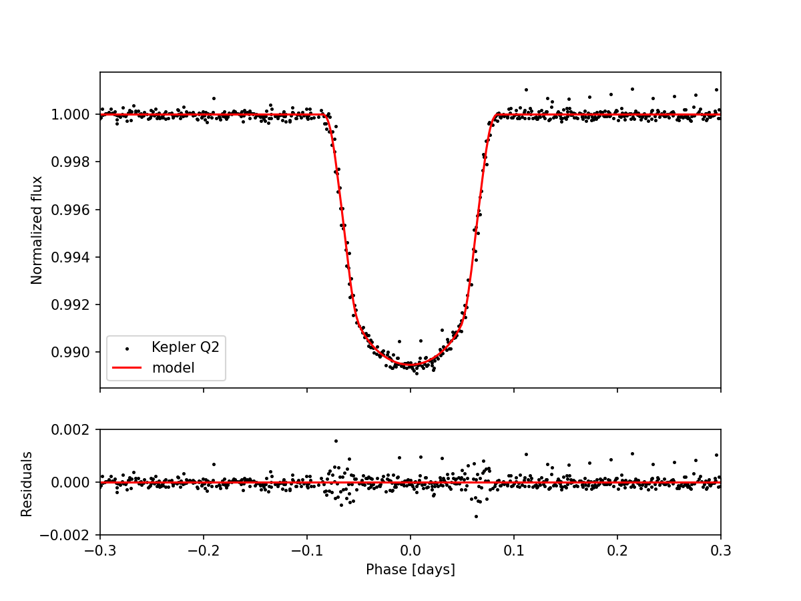
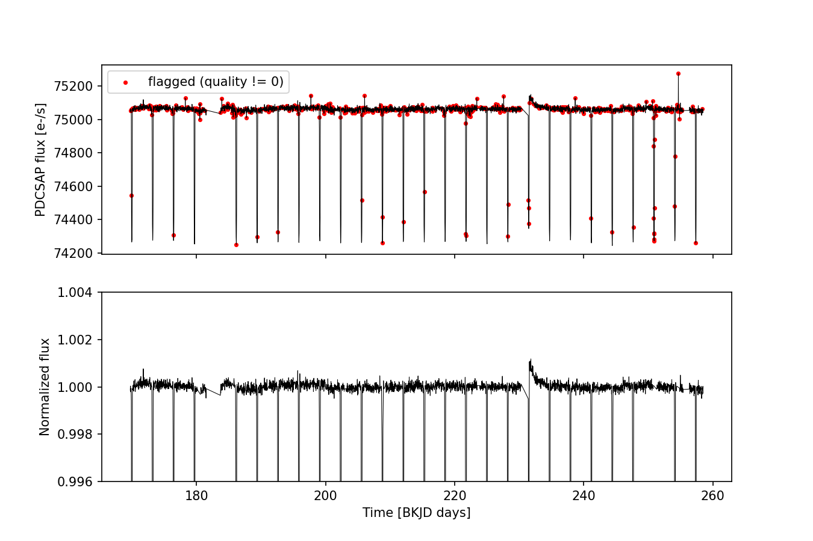

 # Exoplanet Transit Detection - Kepler-6b
Blind detection and characterization of a transiting hot Jupitter from real Kepler photometry, using Python, Lightkurve and batman.


## Summary
The transit signal of Kepler-6b (KIC 10874614) is detected in Kepler Quarter 2 data without assuming its period, then characterized with a physical transit model. The measured orbital period and transit depth reproduce the literatuyre values to better than 1%, and the planet-to-star radius ratio agrees within about 2 sigma.

|Quantity|This analysis|Reference|
|---|---|---|
|Orbital period|3.23452 d|3.2347 d|
|Transit depth|0.01055|0.0106|
|Rp/R★|0.0954±0.0013|0.093




## Objective
Detect a periodic transit signal in raw survey data, measure its properties and quantiry how well the analysis reproduces known values, following the path:
observational data --> cleaning -->detection -->measurement -->physical interpretation --> comparison with the literature
The reference values (period 3.2347 d, depth 1.06%, Rp/R★ 0.093) are used **only** in the final comparison, never as an imput. The period search covers 0.5-20 days with no hint of the expected value.
Kepler-6b is a good test case for a first end-to-end pipeline: its transit is deep (about 1%) and repeats every 3.2 days, so a quarter of data contains about 25 transits, and its paramenters are well known, which allows an honest check of the results.


## Pipeline


## Scientific Background
**Transit method.** When a planet passes in front of its star, the observer flux drops. The fractional drop is the transit depth. To first order the planet is a dark disk in front of a uniformly bright stellar disc, so the depthis the ratio of the two areas:
```
δ = ΔF / F ≈ (Rp / R★)²
```
**Limb darkening.**The stellar disc is brighter at the centre than at the edge. With a linear law the intensity is l(mu)=1-u(1-mu), where mu is the cosine of the angle from the disc centre. The mean intensity over the disc is 1-u/3. A planet crossing near the centre blocks a region brighter than the average, so the plain formula above overestimates the radius ratio. For a central transit a better first estimate is:
```
Rp / R★ ≈ √( δ · (1 − u/3) )
```
Limb darkening also rounds the bottom of the transit, which is clearly visible in the data.
**Transit geometry.** For a circular orbitand a central transit the duration is related to the orbit size by:
```
T ≈ (P / π) · (R★ / a) · (1 + Rp / R★)
```
The impact parameter is b=(a/R★)cos i, where i is the orbital inclination.
**Stellar density from the transit.** For a circular orbit, Kepler's third law links the orbit size in the stellar radii to the mean density of the star, with no need to know the stellar radius:
```
ρ★ = 3π / (G · P²) · (a / R★)³
```
**Box Least Squares (BLS).** For each trial period the light curve is folded and a box-shaped dip is fitted. The period that gives the best box is the best candidate. BLS suits transit because they are short, flat-bottomed drips repeating at a constant period.


## Data

|Property|Value|
|---|---|
|Mission|NASA Kepler|
|Target|Kepler-6 (KIC 10874614)|
|Observation|Quarter 2, 2009|
|Cadence|30 minutes (1800s)|

Data are downloaded from the MAST archieve with Lightkurve. PDCSAP flux is the Kepler pipeline product in which common instrumental trends have already been removed.


## Data Cleaning

|Step|Points left|Reason|
|---|---|---|
|Raw light curve|4075||
|Remove NaNs|4070|missing measurements|
|Keep quality flag 0|3456|removes 614 flagged cadences|
|Upper-side 4 sigma clipping|3456|no point removed|


**Quality flags.** The 614 flagged points belong to a few kinds of disturbance:

|Flag|Meaning|Points|
|---|---|---|
|16|Zero crossing|82|
|128|Cosmic ray in optimal aperture|81|
|128+16|both oof the above|12|
|8192|Cosmic ray in collateral data|217|
|262144+131072|Rolling band (full mask and optimal aperture)|187|
|other combinations||35|

Flags are stored as sums of powers of two, so each value was decoded bit by bit. None of them indicates a serious failure such as a safe mode, and the flagged points are scattered along the whole light curve, not clustered. A few of them fail inside transits.
**Normalization.** The flux is divided by its median, so the depth reads directly as a fraction of the flux. Check: the median of the normalized flux (1.0012) is compatible with the noise, while the minimum (0.9891) is the bottom of the transit.
**Outliners.** Only points above the baseline are clipped (4 sigma), because a transit is a dip and low points are the signal. No point was removed: the maximum of the normalized flux (1.0012) is compatible with the noise, while the minimum (0.9891) is the bottom of the transits.
**Baseline.** After normalization the baseline is flat to within about 0.1%. The only visible feature is a small instrumental ramp after a gap near day 231. Transits are about ten times deeper than the baseline variations.


### Analysis decisions

|Decision|Alternative|reason|
|---|---|---|
|Keep only quality flag 0|Keep flagged points|The disturbances (cosmic rays, rolling band) can bias the depth, and 3456 points are enough|
|Clip outliners on the upper side only|Simmetric sigma clipping|Symmetric clipping would remove points at the bottom of the transit|
|No detrending (flatten)|Flatten before the search|The baseline is already flat and detrending can distort the transit. It is left as a future comparison|
|Wide BLS, then narrow BLS| One fine BLS over the full range|A step of 5e-6 d over 0.5-20 d is about 3.9 million trial periods. Two stages give the same precision at a fraction of the cost|
|Fit the limb-darkening coefficient|Fix it at a typical value|It is unknown, and fixing it changes Rp/R★ by about 2% (see the sensitivity table)|
|Supersample each exposure|Compute the model at one instant|A 30-minute exposure is about 14% of the transit duration, so it visibly smears ingress and egress|
| Fit only within 0.3 d of the transit centre | Fit all phases | Leaves out the instrumental ramp after the transit, while still anchoring the baseline |


## Transit detection
**Wide search.** BLS over 0.5-20 days (20000 trial periods) with four trial durations (0.05, 0.1, 0.15 and 0.2 d). The strongest peak is at 3.2350 d.
**Refinement.** The first gridhas steps of 0.001 d, enough to find the signal but not to fold about 25 transits accurately: a period error of 0.0005 d shifts a transit 13 cycles away by about 9 minutes, which smears and egress in the folded curve. A second BLS on a narrow grid around the peak (step 5e-6 d. curations 0.10 to 0.19 d) gives the refined period of **3.234515 d**.
**Validation of the detection.** All transits are folded on the refined period. They overlap into a single, sharp, rounded dip with a flat baseline and no other dips over the whole orbital phase. A wrong period, or a multiple or sub-multiple of the true one, would give a smeared or double dip. 


## Measurement
**Depth.** The median flux out of transit minus the median flux at the bottom of the transit (|phase|<0.03 d, 69 points) gives a depth of 0.010501, and a first estiate sqrt(depth)=0.1025.
**Duration.** The phase range where the flux is below 0.999 runs from -0.0764 to +0.0803 d, so the observed width is about 0.157 d (3.8 hours). For a central transit this gives a/R★ of about 7.2, used as the starting point for the fit.

## Transit Model
A batman model with linear limb darkening and a circular orbit is fitted to the folded data with scipy curve_fit.

|Parameter|Starting value|Bounds|
|---|---|---|
|Mid-transit time offset [d] |0| -0.02 to 0.02|
|Rp/R★| 0.0917 (from the measured depth)|0.05 to 0.15|
|a/R★|7|3 to 15|
|Impact parameter b|0.1|0 to 0.9|
|Limb darkening u|0.6|0 to 1|

The orbital period is fixed to the refined BLS value. Each Kepler point is an averageo over a 30-minute exposure, so every model point is computed with 7 sub-exposures (exposure time 0.0204 d). None of the fitted values line on a bound.

## Results

### Comparison with the time reference values

|Quantity|This analysis|Reference|Difference|
|---|---|---|---|
|Orbital period|3.23452 d|3.2347 d|-0.00018 d(-0.006%)|
|Transit depth|0.01055|0.0106|-0.5%|
|Rp/R★|0.0954±0.0013|0.093|+2.6% (about 1.9 sigma)|

The period and the depth agree with the reference to better than 1%. Rp/R★ agrees within about 2 sigma. The reference values have their own uncertainties, which are not included in this comparison.

### Fitted model parameters

|Parameter|Value|
|---|---|
|Mid-transit time offset|-0.0004±0.0001 d|
|Rp/R★|0.0954±0.0013|
|a/R★|7.50±0.44|
|Impact parameter b|0.25±0.23|
|Limb darkening u (linear)|0.461±0.019|

The impact parameter is poorly constrained: the data cannot distinguish a central transit from a slightly off-centre one. It is correlated with a/R★, u and Rp/R★.

### Derived quantities

|Quantity|Value|Notes|
|---|---|---|
|Transition duration T14 (first to last contract)|0.147 d (3.5h)|from the fitted model|
|Full-depth duration T23|about 2.9 h|from the fitted model|
|Orbital inclination|about 88 degrees|between about86.3 and 90 degrees for b within 1 sigma|
|Mean stellar density|760 kg/m^3, or 0.54±0.09 solar|from a a/R★ and the period, circular orbit|
|Detection significance|depth/statistical error of about 320|conservative estimate|

The width measured at the 0.999 level (0.157 d) is larger than the model T14 (0.147 d). This is consistent with each point being a 30-minute average, which widens ingress and egress in the data. This was not tested separately.
The stellar density depends on the circular-orbit assumption, and its uncertainty propagates the error on a/R★, ignoring the correlation with b. For scale: for a star with the radius of the Sun, Rp/R★=0.0954 corresponds to about 0.93 Jupiter radii. The actual planet radius requires an indipendent value of the stellar radius, which is not used here.

### How the radius ratio improves with the physics

|Estimate|Rp/R★|
|---|---|
|sqrt(depth), no limb darkening|0.1025|
|sqrt(depth(1-u/3)), u=0.6|o.0917|
|Full model fit|0.0954±0.0013|
|Reference|0.093|

The plain estimate is about 10% too high because it ignores limb darkening. Including it removes most of the discrepancy.

## Uncertainty Budget

|Source|Effect on Rp/R★|
|---|---|
|Noise on the depth alone (standard derivation/sqrt(N), 69 points)|about 0.0002|
|Limb darkening (u from 0.5 to 0.7, analytic correction)|about ±0.002|
|Full fit, including correlations between parameters|±0.0013|

When the analytic correction and u fixed by hand:
|u|Rp/R★|
|---|---|
|0.5|0.0935|
|0.6|0.0917|
|0.7|0.0897|

The limb darkening term is about ten times larger than the noise term, so the result is limited by the model assumptions, not by the quality of the data. This is why u is fitted together with the other partecipants. The fit uncertainty (0.0013) is larger than the noise alone (0.0002) because the parameters are correlated: the model can trade a change in Rp/R★ against changes in a/R★, b and u.
The reference valud (0.093) is not used to tune any parameter: the fitted u (0.46) is simply the value the data prefer.


## Fit Diagnostics
Standard deviation of the residuald (data minus model) as the model was improved step by step:

|Model|In transit|Out of transit|
|---|---|---|
|Parameters set by hand (Rp/R★0.0917, a/R★7.17, b=0, U=0.6)|1.0e-3|1.6e-4|
|+transit centre shifted by 0.002 d|8.4e-4|1.6e-4|
|+30-minute exposure supersampling|7.1e-4|1.6e-4|
|+refined period|6.3e-4|1.6e-4|
|+full fit|3.2e-4|1.6e-4|

The out-of-transit scatter (about 160 ppm per point) is the noise floor. The residual plot of the hand set model showed two spikes of opposite sign on the two transit wall, the signature of a shifted transit centre, which led to the first correction. No single correction explained the whole mismatch: each removed part of it, and the fit removed the largest part.
In transit the residuals are still about twice the noise floor. The remaining scatter is concentrated on ingress and egress, where the light curve is steep and small timing errors become large faux errors. Possible causes are the simple linear limb-darkening law and small timing differences between individual transits. These are hypotheses and were not tested.


## Sanity Checks
- The median of the normalized flux is 1 by construction, and the minimum and maximum are consistent with thetransit depth and the noise.
- The detected period is 0.006% form the reference, although the search range spans a factor of 40 in period.
- The folded curve shows one sharp dip and a flat baseline over the whole orbital phase.
- The out-of-transit residuals are flat and do no change between model versions.
- The whole analysis was re-run from scratch in a fresh Google Colab runtime and reproduced the same numbers.


## Visualization
Lightcurve of Quarter 2. 
Top: raw PDCSAP flux with the flagged cadences in red. Bottom: cleaned and normalized flux, zoomed on the baseline (the transits are cut off by the axis limit on purpose).



Folded light curve (top) with the fitted model in red, and residuals (bottom).


## Limitations
- A single quarter of data (about 25 transits, with a few orbital cycles falling in data gaps).
- Linear limb darkening only. A quadratic law is more realistic and may reduce residuals on the transit walls.
- The impact parameter is poorly constrained and correlated with a/R★, u and Rp/R★. The quoted uncertainty on Rp/R★ includes these correlations through the fit covariance, which assumes the fit is close to linear around the minimum. A sampling method (MCMC) would test this.
- The Period has no error bar, since it comes from the BLS peak.
- No detrending was applied: the small ramp after 231 is excluded from the fit with a indow cut, not modelled.
- Circular orbit assumed. The derived stellar density depends on this assumption.
- The planet radius in physical units is not computed, since it needs an independent valud of the stellar radius.
- The reference values are taken from the literature and not re-derived here. 
- The data product is selected by position in the search results (index 8). If the MAST ordering changes, the index must be updated.


## Future Improvements
- Quadratic limb darkening.
- Posterior sampling with MCMC (for example emcee) to obtain correct uncertainties and parameter correlations.
- Fit several quarters to reduce the uncertainty.
- Period error from the times of individual transits, which also allows a search a searcj for transit timing variations.
- Odd-even depth comparison and a search for a secondary eclipse, as checks on the planetary nature of the signal.
- Compare with a flattened light curve.
- Search for additional signals in the residuals.
- Combine with the stellar radius from the literature to convert Rp/R* into physical units.
